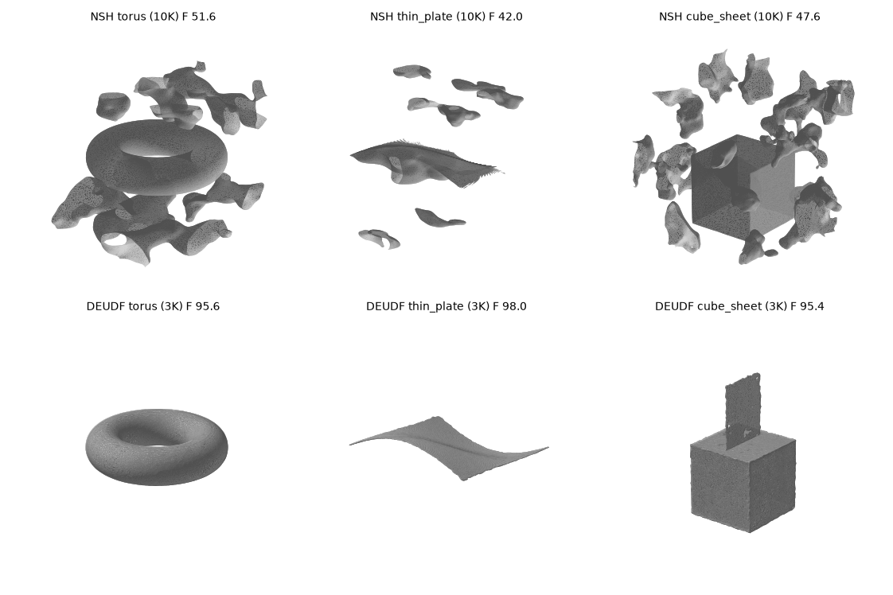

# Results

All runs share one pipeline: SIREN backbone, per-paper query sampling, Marching
Cubes extraction and one evaluation protocol (NSH §5.2): 100K points sampled from
each mesh, F-score threshold 0.005, **both meshes normalised to [−0.5, 0.5]³ with the
ground truth's centre and scale**. After Marching Cubes, every connected component
with at least 5% of the largest one's faces is kept, for every method.

Input: 20K points sampled from the ground-truth mesh, no noise, seed 0. Grid 256³.

## Main results

| shape | method | iterations | CD-L1 ×10³ ↓ | F-score ↑ | Normal C. ↑ | components (kept) | main surface only: F / CD-L1 ×10³ |
|---|---|---|---:|---:|---:|---:|---|
| `torus` | NSH | 10K (Colab) | 100.40 | 51.6 | 87.0 | 16 (9) | **98.4 / 2.20** |
| `torus` | DEUDF | **3K, short run** | 3.34 | 95.6 | 99.2 | 2 (1) | same (one component) |
| `thin_plate` | NSH | 10K (Colab) | 113.76 | 42.0 | 88.5 | 1727 (6) | 54.8 / 45.47 |
| `thin_plate` | DEUDF | **3K, short run** | 2.91 | 98.0 | 98.6 | 1 (1) | same (one component) |
| `cube_sheet` | NSH | 10K (Colab) | 109.25 | 47.6 | 82.1 | 47 (14) | 93.9 / 13.29 — cube only, 0% of the sheet |
| `cube_sheet` | DEUDF | **3K, short run** | 3.12 | 95.4 | 98.9 | 2 (1) | same (one component) |

**Why NSH's full mesh scores so much lower than its main surface.** The gap is ghost
sheets in space NSH's losses never see. In our setup NSH samples its far-field points
only in the point cloud's bounding box padded by 0.1 (|z| ≤ 0.34 for the torus),
while DEUDF and MPF now sample [−1, 1]³, the whole Marching Cubes domain. Every ghost
component lies entirely outside NSH's sampled region. So the full-mesh numbers compare
NSH under a smaller sampling domain than the other two methods.

**Next step:** rerun NSH with Ω = [−1, 1]³ for a like-for-like comparison.

**DEUDF rows are short runs: 3K iterations, local (Apple MPS); the full 30K runs are
pending.** NSH rows are the Colab (T4) 10K-iteration runs, re-extracted and re-scored
from their final checkpoints without retraining. MPF is still being debugged and is
not in this table.

### NSH: what changed with the metric fix

The same NSH meshes, scored three ways:

| shape | reported before: largest component only, old metric | old metric, all components ≥ 5% | **new: ground-truth frame, all components ≥ 5%** | ground-truth frame, largest component only |
|---|---:|---:|---:|---:|
| `torus` | F 98.3 / CD 2.25 | F 3.7 | **F 51.6 / CD 100.40** | F 98.4 / CD 2.20 |
| `thin_plate` | F 8.2 / CD 43.41 | F 6.3 | **F 42.0 / CD 113.76** | F 54.8 / CD 45.47 |
| `cube_sheet` | F 6.9 / CD 203.89 | F 7.2 | **F 47.6 / CD 109.25** | F 93.9 / CD 13.29 |

Two separate effects:

- **The old metric normalised each mesh by its own bounding box.** Any geometry that
  changed the reconstruction's bounding box rescaled all of it relative to the ground
  truth. The new metric uses the ground truth's frame for both meshes.
- **The old code kept only the largest component.** NSH's extra components are
  ghost sheets, and every one of them (≥ 5% of the main surface) lies entirely outside
  the region NSH samples for its far-field losses: the point cloud's bounding box,
  padded by 0.1 (|z| ≤ 0.34 for the torus), while Marching Cubes covers [−1, 1]³. No
  loss term sees that space. Counting them, as for every other method, costs NSH about
  half its F-score on every shape. The main surface alone matches the paper's quality
  on the torus (F 98.4). On `cube_sheet` the main component is the cube only — see
  below.

The same unconstrained-space issue was fixed for MPF by sampling free space in
[−1, 1]³ (see the README). It has not been changed for NSH, whose paper samples the
bounding box.

### Reading the table

**NSH reconstructs the torus surface itself well** (main surface F 98.4, CD 2.20×10⁻³),
but adds ghost sheets in space its losses never sample. On `thin_plate` the main
surface is also poor (F 54.8): an open sheet of zero thickness has no inside/outside,
so an SDF has no well-posed target. On `cube_sheet` NSH reconstructs the cube but
**loses the sheet entirely**: its main component recovers 0% of the sheet (within the
F threshold), against 99% for DEUDF. Its main-component F stays at 93.9 only because
the sheet is 9% of the shape's surface area, so F alone understates this failure.

**DEUDF reconstructs all three shapes** after 3K iterations, including the open sheet
and the non-manifold junction, with f at the input points within ±0.009 of zero. Its
meshes are Marching Cubes double covers at a small iso-level (≈ 0.006 at 256³), not
DCUDF, so CD includes the offset between the two sheets.

### Reproduce

```bash
# DEUDF short runs
python train.py --method deudf --shape <shape> --iters 3000 --res 256 --seed 0 --ckpt_every 3000 --out out/deudf_3k
# NSH: re-score a finished run from its checkpoint (no retraining)
python reextract.py out/colab_nsh/<shape>_nsh --res 256
```



*Gallery: the meshes in the main table. NSH's ghost sheets are the extra surfaces
around the shapes.*

## Old results (invalid: old metric and/or pre-fix code)

Kept for the record; do not cite. These were produced before the fixes in the README
(MPF loss weights, DEUDF attenuation, DEUDF `L_positive` point set, data-anchored
iso-level, component filter, ground-truth-frame metric).

**Colab, 10K iterations, 20K points, res 256, commit `0846712`** (old metric, largest
component only; DEUDF and MPF before the DEUDF fixes):

| shape | method | CD-L1 ×10³ | F-score |
|---|---|---:|---:|
| `torus` | NSH | 2.25 | 98.3 |
| `thin_plate` | NSH | 43.41 | 8.2 |
| `cube_sheet` | NSH | 203.89 | 6.9 |
| `torus` | DEUDF | — | 2.9 |
| `thin_plate` | DEUDF | — | 1.9 |
| `cube_sheet` | DEUDF | — | 2.6 |
| `torus` | MPF | — | 3.1 |

**CPU, September 2026** (6K input points, 8K for the torus, batch 2000, res 128;
before the MPF weight fix and the DEUDF attenuation fix; old metric):

| shape | method | iters | CD-L1 ×10³ | F-score | Normal C. | #comp |
|---|---|---:|---:|---:|---:|---:|
| `cube_sheet` | DEUDF | 2000 | 176.51 | 1.4 | 43.8 | 120 |
| `cube_sheet` | MPF | 2500 | 7.59 | 25.5 | 96.3 | 5 |
| `cube_sheet` | NSH | 2000 | 83.50 | 3.2 | 60.5 | 42 |
| `thin_plate` | DEUDF | 2000 | 3.95 | 74.4 | 87.2 | 2 |
| `thin_plate` | MPF | 2000 | 22.42 | 19.2 | 89.8 | 7 |
| `thin_plate` | NSH | 2000 | 64.62 | 4.4 | 86.6 | 247 |
| `torus` | NSH | 1500 | 2.39 | 98.1 | 99.1 | 21 |

Claims made from these tables no longer hold. In particular, "MPF is the only method
that handles `cube_sheet`" and "DEUDF struggles on `cube_sheet`" are both
contradicted by the main results above.
